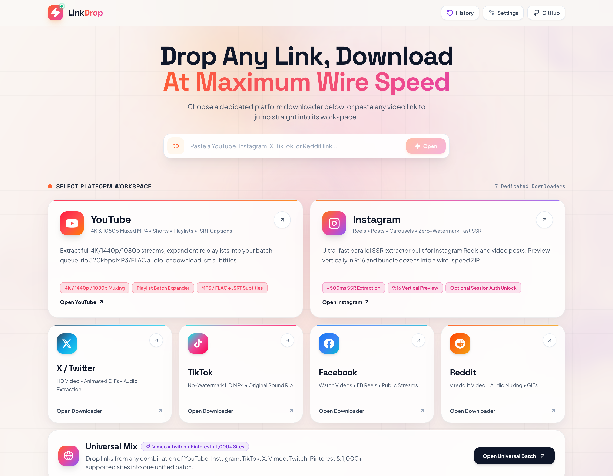
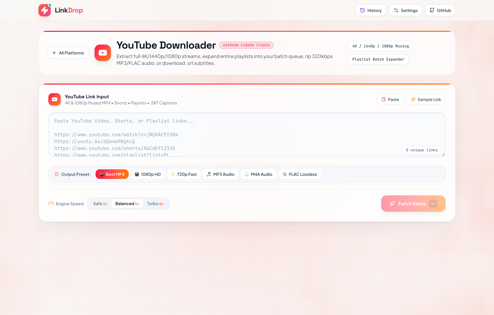
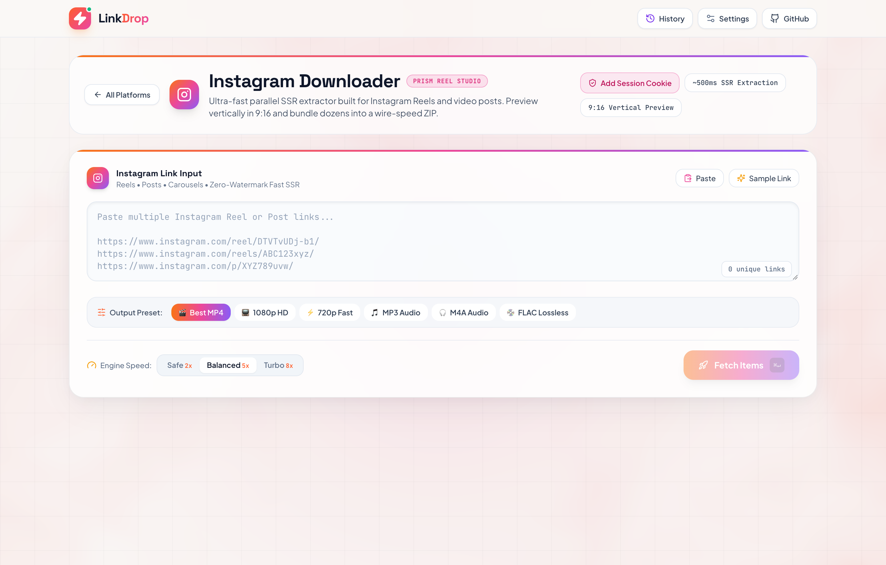
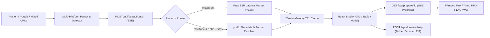

<div align="center">

<!-- Animated Wave Hero Banner -->


<!-- Animated Typing Tagline -->
<p align="center">
  
</p>

<p align="center">
  <a href="https://nodejs.org/"></a>
  <a href="https://react.dev/"></a>
  <a href="https://tailwindcss.com/"></a>
  <a href="https://github.com/yt-dlp/yt-dlp"></a>
  <a href="https://ffmpeg.org/"></a>
  <a href="LICENSE"></a>
</p>

<p align="center">
  <a href="#-screenshots">Screenshots</a> •
  <a href="#-supported-platforms">Platforms</a> •
  <a href="#-key-features">Features</a> •
  <a href="#-architecture">Architecture</a> •
  <a href="#-quick-start">Quick Start</a> •
  <a href="#-api-reference">API Reference</a>
</p>

</div>

---

## 📸 Screenshots

<div align="center">
  <p><strong>Home Portal — Quick Auto-Route Bar &amp; 7 Dedicated Platform Downloaders</strong></p>
  
</div>

<br />

<table>
  <tr>
    <td width="50%" align="center">
      <strong>YouTube Downloader Studio</strong><br />
      <sub>4K/1080p Muxing • Playlist Batch Expander • .SRT Captions</sub>
      <br /><br />
      
    </td>
    <td width="50%" align="center">
      <strong>Instagram Downloader Studio</strong><br />
      <sub>~500ms SSR Extraction • 9:16 Vertical Cards • Session Cookie Auth</sub>
      <br /><br />
      
    </td>
  </tr>
</table>

---

## 🌐 Supported Platforms

| Platform | Dedicated Studio Highlights |
| :--- | :--- |
| **YouTube** | Videos, Shorts &amp; Music • **4K / 1440p / 1080p Muxed MP4** • **Playlist Batch Expander** • `.srt` Subtitles |
| **Instagram** | Reels, Posts &amp; Carousels via **Fast SSR Engine (~500ms)** • 9:16 Vertical Previews • Optional `sessionid` unlock |
| **X / Twitter** | Native HD Video &amp; GIF Tweets • Clip Trimming • Batch ZIP Archiving |
| **TikTok** | Watermark-Free HD MP4s • 1-Click Sound Rip (MP3 / FLAC) • 9:16 Cards |
| **Facebook** | Watch Videos, FB Reels &amp; `fb.watch` shortlinks • Multi-Quality Picker |
| **Reddit** | Auto Audio + Video `v.redd.it` FFmpeg Muxing (zero silent clips) |
| **Universal Mix** | Vimeo, Twitch, Pinterest &amp; **1,000+ sites** combined in one queue with folder-grouped ZIP export |

---

## ✨ Key Features

<table>
  <tr>
    <td width="50%">
      <h3>🎯 Dedicated Per-Platform Studios</h3>
      <p>Launch straight into a tailored downloader workspace from the Home Portal or paste any link into the Quick-Launch bar to auto-detect and jump to the matching studio.</p>
    </td>
    <td width="50%">
      <h3>⚡ Bounded Parallel Concurrency</h3>
      <p>Extract 1 to 100+ links concurrently using <code>Safe (2x)</code>, <code>Balanced (5x)</code>, or <code>Turbo (8x)</code> speed presets with live Server-Sent Events (SSE) status updates.</p>
    </td>
  </tr>
  <tr>
    <td width="50%">
      <h3>🎬 4K Video Muxing &amp; Lossless Audio</h3>
      <p>Download progressive HD or FFmpeg-muxed <strong>4K / 1440p / 1080p MP4</strong>, or convert directly to <strong>320kbps MP3, M4A, FLAC, or WAV</strong> with metadata.</p>
    </td>
    <td width="50%">
      <h3>✂️ Clip Trimmer, .SRT Captions &amp; Covers</h3>
      <p>Preview streams inside the Studio Modal, trim exact <code>Start → End</code> timestamp slices before saving, download <code>.srt</code> subtitles, and grab full-res thumbnails.</p>
    </td>
  </tr>
  <tr>
    <td width="50%">
      <h3>📂 Zero-Disk Folder-Grouped ZIP</h3>
      <p>Bundle dozens of videos &amp; audio tracks into a single Store-mode ZIP streamed directly to your browser, neatly organized into <code>YouTube/</code>, <code>Instagram/</code>, and <code>TikTok/</code> folders.</p>
    </td>
    <td width="50%">
      <h3>📜 Playlist Expander &amp; History Drawer</h3>
      <p>Expand full YouTube playlists straight into your batch queue, switch between Grid &amp; Table views, and re-queue past saves from Download History.</p>
    </td>
  </tr>
</table>

---

## 🏗️ Architecture



---

## 🚀 Quick Start

### Prerequisites
- **Node.js 18+**
- **yt-dlp** & **ffmpeg** (`brew install yt-dlp ffmpeg` on macOS, or use the included `Dockerfile`)

### 1. Clone & Install

```bash
git clone https://github.com/i-m-champion/LinkDrop.git
cd LinkDrop
npm install
```

### 2. Development Mode

```bash
npm run dev
```

- Frontend (Vite): **[http://localhost:5173](http://localhost:5173)**
- Backend API: **[http://localhost:3001](http://localhost:3001)**

### 3. Production Build & Serve

```bash
npm run build
npm start
```

Everything runs cleanly on **[http://localhost:3001](http://localhost:3001)**.

### 4. Deploy Anywhere with Docker

```bash
docker build -t linkdrop .
docker run -p 3001:3001 linkdrop
```

### 5. Run Tests

```bash
npm test
```

---

## 🔌 API Reference

| Method | Endpoint | Description |
| :--- | :--- | :--- |
| `GET` | `/api/health` | Service health + live `yt-dlp` / `ffmpeg` capability flags |
| `POST` | `/api/parse` | Parses &amp; deduplicates mixed-platform URLs + playlist flags |
| `POST` | `/api/playlist/expand` | Expands a YouTube playlist URL into queue items |
| `POST` | `/api/extract/batch` | **SSE stream** extracting mixed URLs concurrently |
| `GET` | `/api/thumb/:id` | Proxies thumbnail (`?download=1` saves full-res `.jpg`) |
| `GET` | `/api/subtitles/:id` | Extracts `.srt` subtitles (`?lang=en`) |
| `GET` | `/api/stream/:id` | HTTP `Range` streaming proxy for instant HD preview &amp; direct saves |
| `GET` | `/api/prepare/:id` | **SSE progress** for HD muxing, MP3/M4A/FLAC/WAV conversion &amp; clipping |
| `GET` | `/api/file/:token` | One-time download endpoint with automatic temp cleanup |
| `POST` | `/api/download-zip` | Concurrent mixed-format ZIP bundler with optional platform folders |

---

## ⚠️ Disclaimer

This tool is built for personal archiving, offline viewing, and downloading media you own or have permission to save. Please respect creators' copyrights and platform Terms of Service.

<div align="center">
  <br />
  
  <sub>Built with ⚡ by <a href="https://github.com/i-m-champion">i-m-champion</a></sub>
</div>
