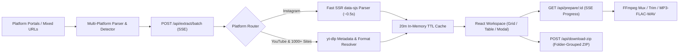

<div align="center">

<!-- Hero Banner -->


<p align="center">
  <a href="https://nodejs.org/"></a>
  <a href="https://react.dev/"></a>
  <a href="https://tailwindcss.com/"></a>
  <a href="https://github.com/yt-dlp/yt-dlp"></a>
  <a href="https://ffmpeg.org/"></a>
</p>

<p align="center">
  <strong>Dedicated downloader workspaces for YouTube, Instagram, X, TikTok, Facebook, Reddit &amp; 1,000+ sites. Extract streams in parallel, convert to 4K MP4 or 320kbps MP3/FLAC, trim exact clips, grab subtitles, and bundle into folder-organized ZIPs.</strong>
</p>

<p align="center">
  <a href="#-supported-platforms">Platforms</a> •
  <a href="#-key-features">Features</a> •
  <a href="#-architecture">Architecture</a> •
  <a href="#-quick-start">Quick Start</a> •
  <a href="#-api-reference">API Reference</a>
</p>

</div>

---

## 🌐 Supported Platforms

| Platform | Capabilities |
| :--- | :--- |
| **YouTube** | Videos, Shorts, Music, **4K/1440p/1080p Muxed MP4**, **Playlist Expander**, `.srt` Subtitles |
| **Instagram** | Reels, Posts, Carousels via **Ultra-Fast SSR Engine** (~0.5s) + optional `sessionid` unlock |
| **TikTok / X / Facebook** | Watermark-free HD MP4s, audio extraction, batch ZIP bundling |
| **Reddit / Vimeo / Twitch / 1,000+ Sites** | Automatic resolution detection, audio conversion, clipping & cover download |

---

## ✨ Key Features

<table>
  <tr>
    <td width="50%">
      <h3>🎯 Dedicated Per-Platform Studios</h3>
      <p>Choose your platform right from the animated LinkDrop Home Portal—each workspace adapts its aspect ratio, presets, hints, and theme for YouTube, Instagram, X, TikTok, Facebook, Reddit, or Mixed Batch.</p>
    </td>
    <td width="50%">
      <h3>🎬 4K Muxing &amp; Audio Rip</h3>
      <p>Choose per-item or batch-wide output: <strong>MP4 (4K / 1440p / 1080p / 720p)</strong> muxed cleanly via <code>ffmpeg</code>, or extract <strong>MP3 (320k), M4A, FLAC, WAV</strong> with embedded cover art.</p>
    </td>
  </tr>
  <tr>
    <td width="50%">
      <h3>✂️ Clip Trimmer, Subtitles &amp; Covers</h3>
      <p>Preview in HD inside the Studio Modal, trim exact <code>Start → End</code> timestamp segments, download <code>.srt</code> captions, and save full-resolution thumbnails.</p>
    </td>
    <td width="50%">
      <h3>📂 Folder-Grouped Store-Mode ZIP</h3>
      <p>Bundle dozens of videos &amp; audio tracks into one archive organized into platform folders (<code>YouTube/</code>, <code>Instagram/</code>, <code>TikTok/</code>) at wire speed.</p>
    </td>
  </tr>
  <tr>
    <td width="50%">
      <h3>📜 Playlist Expander</h3>
      <p>Drop any YouTube Playlist link and click <strong>Expand Playlist</strong> to populate up to 30+ videos directly into your batch studio queue.</p>
    </td>
    <td width="50%">
      <h3>⚡ Animated Light UI + History Drawer</h3>
      <p>Airy, animated light-mode studio with custom morphing pointer interactions, Grid &amp; Table views, and instant re-queueing from Download History.</p>
    </td>
  </tr>
</table>

---

## 🏗️ Architecture



---

## 🚀 Quick Start

### Prerequisites
- **Node.js 18+**
- **yt-dlp** & **ffmpeg** (installed on macOS via `brew install yt-dlp ffmpeg`, or use the included `Dockerfile`)

### 1. Clone & Install

```bash
git clone https://github.com/i-m-champion/LinkDrop.git
cd LinkDrop
npm install
```

### 2. Run in Development Mode

```bash
npm run dev
```

- Frontend (Vite): **[http://localhost:5173](http://localhost:5173)**
- Backend API: **[http://localhost:3001](http://localhost:3001)**

### 3. Build & Run in Production

```bash
npm run build
npm start
```

Everything runs on **[http://localhost:3001](http://localhost:3001)**.

### 4. Deploy Anywhere with Docker

```bash
docker build -t linkdrop .
docker run -p 3001:3001 linkdrop
```

### 5. Run Tests

```bash
npm test
```

---

## 🔌 API Reference

| Method | Endpoint | Description |
| :--- | :--- | :--- |
| `GET` | `/api/health` | Service health + live `yt-dlp` / `ffmpeg` capability flags |
| `POST` | `/api/parse` | Parses & deduplicates mixed-platform URLs + playlist flags |
| `POST` | `/api/playlist/expand` | Expands a YouTube playlist URL into queue items |
| `POST` | `/api/extract/batch` | **SSE stream** extracting mixed URLs concurrently |
| `GET` | `/api/thumb/:id` | Proxies thumbnail (`?download=1` saves full-res `.jpg`) |
| `GET` | `/api/subtitles/:id` | Extracts `.srt` subtitles (`?lang=en`) |
| `GET` | `/api/stream/:id` | HTTP `Range` streaming proxy for instant HD preview & direct saves |
| `GET` | `/api/prepare/:id` | **SSE progress** for HD muxing, MP3/M4A/FLAC/WAV conversion & clipping |
| `GET` | `/api/file/:token` | One-time download endpoint with automatic temp cleanup |
| `POST` | `/api/download-zip` | Concurrent mixed-format ZIP bundler with optional platform folders |

---

## ⚠️ Disclaimer

This tool is designed for personal archiving, offline viewing, and downloading content you own or have permission to save. Please respect creators' copyrights and platform Terms of Service.

<div align="center">
  <br />
  <sub>Built with ⚡ by <a href="https://github.com/i-m-champion">i-m-champion</a></sub>
</div>
