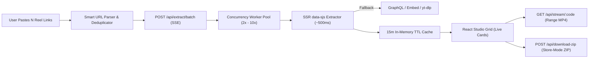

<div align="center">

<!-- Hero Banner -->


<p align="center">
  <a href="https://nodejs.org/"></a>
  <a href="https://react.dev/"></a>
  <a href="https://tailwindcss.com/"></a>
  <a href="https://expressjs.com/"></a>
  <a href="https://github.com/i-m-champion/Insta-downloader/blob/main/LICENSE"></a>
</p>

<p align="center">
  <strong>Paste dozens of Instagram Reel links at once. Extract streams concurrently in real time, preview in HD, and download your entire batch in a single wire-speed ZIP.</strong>
</p>

<p align="center">
  <a href="#-key-features">Features</a> •
  <a href="#-architecture">Architecture</a> •
  <a href="#-quick-start">Quick Start</a> •
  <a href="#-api-reference">API Reference</a> •
  <a href="#-performance-engineering">Performance</a>
</p>

</div>

---

## ✨ Key Features

<table>
  <tr>
    <td width="50%">
      <h3>⚡ Parallel Multi-Link Extraction</h3>
      <p>Resolve up to <strong>100 Instagram Reel & Post URLs</strong> simultaneously using a configurable worker pool (<code>2x Safe</code>, <code>5x Balanced</code>, <code>8x Turbo</code>) with live <strong>Server-Sent Events (SSE)</strong> streaming progress.</p>
    </td>
    <td width="50%">
      <h3>📦 Wire-Speed Store-Mode ZIP</h3>
      <p>Bundle dozens of HD MP4s into one archive using <strong>zero-compression ZIP streaming</strong> (<code>zlib level 0</code>) with parallel CDN prefetch windows and live MB/s throughput telemetry.</p>
    </td>
  </tr>
  <tr>
    <td width="50%">
      <h3>🧠 Smart Messy-Text URL Parser</h3>
      <p>Paste links separated by spaces, commas, newlines, or copied straight from WhatsApp/Notes — ReelJet automatically extracts, normalizes, and deduplicates every shortcode.</p>
    </td>
    <td width="50%">
      <h3>🎬 Studio Preview & Range Proxy</h3>
      <p>Inspect thumbnails, captions, creator handles, audio attribution, and scrub full HD video inside a sleek theater modal via an HTTP <code>Range</code>-capable streaming proxy.</p>
    </td>
  </tr>
  <tr>
    <td width="50%">
      <h3>🛡️ Multi-Strategy Fallback Engine</h3>
      <p>Combines ultra-fast SSR <code>data-sjs</code> JSON parsing, GraphQL fallback, Embed endpoint extraction, and optional local <code>yt-dlp</code> fallback with automatic 15-minute TTL caching.</p>
    </td>
    <td width="50%">
      <h3>🔐 Optional Session Unlock</h3>
      <p>Optionally supply your browser's <code>sessionid</code> cookie in <strong>Studio Settings</strong> to unlock age-restricted reels. Stored strictly in your browser's <code>localStorage</code>.</p>
    </td>
  </tr>
</table>

---

## 🏗️ Architecture

ReelJet eliminates disk buffering and sequential bottlenecks by streaming directly from Instagram's CDN through a bounded-concurrency Express pipeline:



---

## 🚀 Quick Start

### Prerequisites
- **Node.js 18+** (tested on Node 20–26)
- **npm 9+**
- *(Optional)* `yt-dlp` installed globally if you want an extra fallback layer

### 1. Clone & Install

```bash
git clone https://github.com/i-m-champion/Insta-downloader.git
cd Insta-downloader
npm install
```

### 2. Run in Development Mode (Hot Reload)

Starts both the Express API server (`http://localhost:3001`) and the Vite React frontend (`http://localhost:5173`):

```bash
npm run dev
```

Open **[http://localhost:5173](http://localhost:5173)** in your browser.

### 3. Build & Run in Production (Single Server)

```bash
npm run build
npm start
```

Everything is served cleanly from **[http://localhost:3001](http://localhost:3001)**.

### 4. Run Tests

```bash
npm test
```

---

## 🎯 How to Use

1. **Paste Links** — Drop 1 or 50+ Instagram Reel/Post URLs into the **Batch Link Studio** (or click **Paste** / **Sample Link**).
2. **Choose Speed** — Pick `Safe (2x)`, `Balanced (5x)`, or `Turbo (8x)` concurrency (or fine-tune 1–10 threads in **Studio Settings**).
3. **Fetch Batch** — Click **Fetch Reels** (or press `⌘ + Enter` / `Ctrl + Enter`). Watch cards stream in live with thumbnails, resolution, duration, and file sizes.
4. **Download Everything**:
   - Click **Download ZIP** to bundle all selected reels into a single `.zip` at wire speed.
   - Click **Download All MP4s** to save each video individually.
   - Or click any card's **Play** button to preview in HD before saving.

---

## 🔌 API Reference

| Method | Endpoint | Description |
| :--- | :--- | :--- |
| `GET` | `/api/health` | Health check and service status |
| `POST` | `/api/parse` | Extracts and deduplicates Instagram shortcodes from raw text |
| `POST` | `/api/extract/batch` | **SSE stream** resolving multiple reels concurrently (`{ items, concurrency, sessionId }`) |
| `GET` | `/api/thumb/:shortcode` | Proxies CDN thumbnails cleanly with CORS/CORP headers handled |
| `GET` | `/api/stream/:shortcode` | Streams HD MP4 with `Range` seeking support (`?download=1&filename=...` for attachment) |
| `POST` | `/api/download-zip` | Concurrent prefetch + **Store-mode ZIP** streaming (`{ shortcodes, template, concurrency }`) |

---

## ⚡ Performance Engineering

Why is ReelJet noticeably faster than typical web downloaders?

1. **Zero Headless Browser Overhead** — No Puppeteer/Playwright startup tax. Primary extraction parses Instagram's SSR `data-sjs` payload in a single HTTP request (~0.5–1.5s).
2. **Bounded Parallelism** — A custom async worker pool resolves batches concurrently instead of one-by-one, cutting a 20-reel batch from ~25s down to ~3s.
3. **Store-Mode ZIP (`level: 0`)** — H.264/AAC MP4 files are already compressed. Skipping redundant deflate compression removes CPU bottlenecks and lets ZIP downloads run at full network speed.
4. **Prefetch Windows** — During ZIP bundling, multiple CDN video streams are fetched in parallel windows while feeding the archive stream.
5. **TTL Metadata Cache** — Previewing a reel and then downloading it (or including it in a ZIP) reuses the cached stream metadata instantaneously.

---

## 🛠️ Tech Stack

- **Frontend:** React 18, Vite, Tailwind CSS, Lucide Icons, Plus Jakarta Sans & JetBrains Mono
- **Backend:** Node.js, Express, Archiver (streaming ZIP), Native Fetch & Web Streams
- **Testing:** Node.js native test runner (`node --test`)

---

## ⚠️ Disclaimer

This tool is built for personal archiving, educational use, and downloading content you own or have permission to save. Please respect creators' copyrights and Instagram's Terms of Service.

<div align="center">
  <br />
  <sub>Built with ⚡ by <a href="https://github.com/i-m-champion">i-m-champion</a></sub>
</div>

